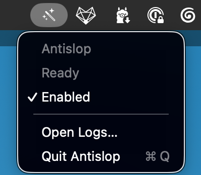
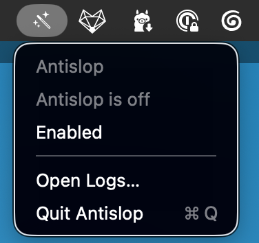

# Antislop MCP

Antislop MCP gives coding agents a local editor that makes audience-facing prose more specific and less like generic AI output.

An MCP server for [Qwen3.8-27B-antislop](https://huggingface.co/AlexWortega/Qwen3.8-27B-antislop). It exposes two tools:

- `antislop_status` checks the local model endpoint.
- `antislop_rewrite` rewrites or continues prose while preserving requested terms.

The MCP adapter does not load model weights. Run Antislop behind any OpenAI-compatible local server. The model card documents vLLM:

```bash
uv venv
source .venv/bin/activate
uv pip install -e .

vllm serve AlexWortega/Qwen3.8-27B-antislop \
  --served-model-name antislop \
  --reasoning-parser qwen3 \
  --default-chat-template-kwargs '{"enable_thinking": false}' \
  --max-model-len 32768
```

In another terminal, register the MCP server:

```bash
codex mcp add antislop -- "$PWD/.venv/bin/antislop-mcp"
```

For a different endpoint:

```bash
export ANTISLOP_BASE_URL=http://127.0.0.1:1234/v1
export ANTISLOP_MODEL=Qwen3.8-27B-antislop
export ANTISLOP_API_KEY=local
```

`antislop_rewrite` supports `polish`, `humanize`, and `continue` modes. It returns the original text on endpoint failure, and rejects output that drops terms listed in `preserve`. These checks cannot prove factual or semantic fidelity; review the result before publishing.

## macOS menu-bar app

The repository can build a small menu-bar app that owns the runner and exposes a private Unix socket to MCP clients. One worker is shared by Codex and other clients, and the model can be unloaded from the menu bar.

This requires macOS, Apple Silicon, Xcode Command Line Tools, a local Python environment, and a compatible OpenAI-style runner such as `llama-server`:

```bash
uv venv
uv pip install -e .
python scripts/build_app.py --output build/Antislop.app --python "$PWD/.venv/bin/python"
python scripts/install.py --app build/Antislop.app --python "$PWD/.venv/bin/python" --runner \
  llama-server -hf rawmodels/Qwen3.8-27B-antislop-GGUF:Q4_K_M \
  --alias antislop --host 127.0.0.1 --port 8000 --jinja \
  --reasoning-budget 0 --no-reasoning-preserve
open "$HOME/Applications/Antislop.app"
```

Then register the socket-backed MCP server as usual:

```bash
codex mcp add antislop -- "$PWD/.venv/bin/antislop-mcp"
```

The MCP adapter opens `Antislop.app` if the socket is not available. Model output and service diagnostics are written to `~/Library/Application Support/Antislop/runner.log` and `controller.log`; drafts are not logged by the controller.

The runner command is configurable in `~/Library/Application Support/Antislop/config.json`, so you can replace `llama-server` with an MLX or LM Studio-compatible server later.

### Using Antislop from Codex

Once the menu-bar app says `Ready`, ask Codex to use the MCP tool explicitly:

```text
Run Antislop on your proposed launch announcement. Preserve the product name,
the date, and every number. Return only the revised announcement.
```

Other useful requests:

```text
Rewrite this email with Antislop. Keep the tone warm but direct, and preserve
all names, dates, URLs, and commitments:

<paste draft here>
```

```text
Use Antislop in `polish` mode on this product description. Keep the structure,
technical terms, and Markdown formatting, but remove generic AI phrasing.
```

```text
Use Antislop in `continue` mode to finish this paragraph naturally. Match the
existing voice and do not repeat the last sentence:

<paste unfinished paragraph here>
```

The app does not rewrite every Codex response automatically. It is an on-demand
MCP tool for drafts and other text you intend to share. The menu-bar controls
let you keep the model loaded, unload it to release memory, open logs, or quit
the service.

### Menu-bar controls

| Ready and enabled | Disabled and unloaded |
| --- | --- |
|  |  |

## Development

```bash
uv run pytest -q
uv run ruff check src tests
```
